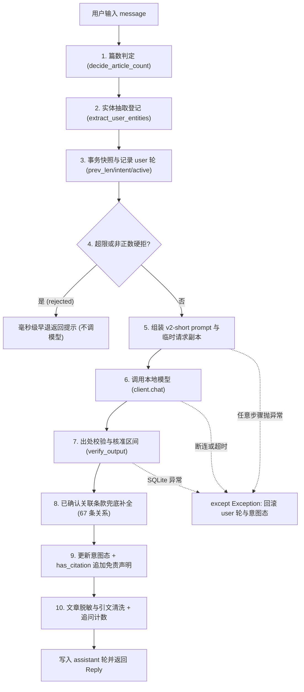

# 第 7 章 推理与演示：模型服务、对话编排与演示界面

本章对应 Phase 2/3/4/7 的 `T024`–`T028`、`T045`–`T047`、`T054`–`T056`、`T069`–`T071` 与 `T073`，拆解自训模型如何从磁盘上的 LoRA 权重变成一套**本地零外连、可审计、可演示**的完整系统。核心源码位于 `src/tu_assistant/{runtime,chat,ui}/` 与 `src/tu_assistant/cli.py`。

> **编号说明**：为保持 `00-glossary.md`、`tasks.md` 及历史执行单中已有编号与锚点 100% 零断链，本章保留早先落地的 `[L7.1]`–`[L7.3]` 原始编号不动，在文末补全 `[L7.4]`–`[L7.7]`。如果你是第一次通读本章，推荐按以下逻辑顺序阅读：**`[L7.4]`（服务与隔离）→ `[L7.3]`（加载权重）→ `[L7.5]`（10 步编排全链路）→ `[L7.1]`（篇数护栏）→ `[L7.2]`（Gradio 演示界面）→ `[L7.6]`（硬件互斥）→ `[L7.7]`（延展提问）**。

## 本章知识点

| 推荐阅读序 | 编号 | 主题 | 核心问题 |
|---|---|---|---|
| 1 | [L7.4](#l74-模型服务与运行时隔离openai-兼容接口currentjson-路由与零外连防线) | 模型服务与运行时隔离 | OpenAI 兼容接口如何解耦？`current.json` 怎么路由？三层零外连防线如何落地？ |
| 2 | [L7.3](#l73-基于底座模型加载训练后权重动态挂载-adapter-vs-合并权重fuse) | 动态挂载 Adapter vs 合并权重（Fuse） | LoRA 产物怎么与底座组合？POC 为什么选动态挂载？ |
| 3 | [L7.5](#l75-对话编排全链路从一条用户消息到可交付回复的-10-步流水线) | 对话编排 10 步全链路 | 一条用户消息如何经过护栏、模型、校验、脱敏与回滚？`tu chat` 与 `tu ui` 实测差在哪？ |
| 4 | [L7.1](#l71-对话编排层的确定性护栏文章数量控制如何与微调模型协作) | 确定性护栏：文章数量控制 | 为什么不改 `v2-short` system prompt？确定性代码与模型怎么分工？ |
| 5 | [L7.2](#l72-本地演示界面的工程边界gradio-6-状态隔离sqlite-跨线程约束与本地隐私护栏) | 本地演示界面的工程边界 | Gradio 6 多线程与 SQLite、会话内存隔离、隐形外连怎么处理？ |
| 6 | [L7.6](#l76-为什么训练与演示不能在-m1-pro32gb上同时进行) | 训练与演示的硬件互斥 | 统一内存账本、内存带宽受限与工程状态隔离为何要求单机互斥？ |
| 7 | [L7.7](#l77-可以继续问的问题) | 可以继续问的问题 | 面向正式阶段与深挖原理的 7 个延展方向 |

---

## [L7.1] 对话编排层的确定性护栏：文章数量控制如何与微调模型协作

在把自训模型接入真实对话时，常会遇到一个核心设计问题：**哪些要求应该写进提示词交给模型，哪些边界必须由外层 Python 代码确定性守住？**

以本项目 FR-028（“用户可以指定生成的普法文章数量，默认 3 篇，单次上限 10 篇”）在 T056 中的落地为例，我们拆解三个关键工程决策。

### 1. 为什么不改全局 `v2-short` system prompt？

早在 `[L5.4]` 中我们验证过：**训练时和推理时的 system prompt 分布必须一致**。当前冻结的 7B 演示模型（`exp-20261116-resume500`）全部训练样本和 60 题基线评测都使用同一份 ≤200 字的 `v2-short` 模板（`src/tu_assistant/chat/prompts.py`）。

如果直接把“默认写 3 篇，最多 10 篇”硬塞进全局 `SYSTEM_TEMPLATE`：
- 所有普通咨询请求（包括 60 题评测集）都会多出一段训练时从未见过的指令，可能扰动已达标的 SC-016 基线；
- 已经明示写 1 篇的路线 A 演示提示词也会受到不必要的上下文漂移。

**做法**：保持 `v2-short` 正文一字不动；只在编排层判定当前轮次属于“未指定篇数的写稿请求（`use_default`）”时，向**当轮发往模型的临时请求副本**末尾附注一句轻量篇数指令，既不修改 `session.messages` 中用户的原话，也对咨询路径、修改轮和已明示篇数的请求实现 **0 字节扰动**。

### 2. 确定性代码 vs 模型能力边界怎么划分？

和此前已经落地的**出处校验层**（`[L3.5]`）、**身份信息脱敏层**（`[L6.3]`）一样，文章数量控制也遵循“**确定性护栏守底线，模型负责语言与内容**”的分工：

| 层次 | 负责什么 | 能否 100% 确定 |
|---|---|---|
| **确定性代码**（`chat/article_count.py` + `chat/orchestrator.py`） | 配置合法性校验（`default/max` 必须为正整数且 `default <= max`）；解析阿拉伯/中文数字与显式区间；剥离法律引文、屏蔽案情干扰与序数词（如“修改第 2 篇”）；拦截 `<= 0` 或 `> max_article_count` 的请求并毫秒级返回提示；保留首轮实体登记；透传 `app.yaml` 配置到 `tu chat` 和 `tu eval run` | **100% 确定**（可用单元测试完全锁死） |
| **微调模型**（`exp-20261116-resume500`） | 根据指令实际产出对应篇数，并保证各篇在主体、场景、情节上有实质差异（SC-010） | **概率性**（受训练数据与模型容量制约，如未训文章的父模型在开放多篇题上易误拒） |

注意两点细微的隔离：
- **硬拒文案与 SC-008 域外拒答隔离**：超限提示避免使用“无法生成”“超出本知识库”等 `detect_refusal` 关键词，防止评测时把“参数超上限”误统计为“知识库范围外拒答”；
- **实体抽取优先于硬拒早退**：即便用户在首轮说“我叫周岚，在栖梧样例厂工作，帮我写 15 篇普法文章”被超限拦截，编排层仍先登记了 `周岚` / `栖梧样例厂`，下一轮用户改成“写 1 篇”时依然能正确脱敏。

### 3. “入口拦截 + 单次调用” vs “编排层按篇循环”的取舍

实现多篇生成有两条路线：
- **方案 A（本项目 POC 采用）：入口拦截 + 单次调用轻量指令**。始终只发 1 次模型请求，与 T052/T057 训练样本（单轮输出多篇、`---` 分隔）的分布一致，延迟可控（不翻倍），`raw_content`、出处校验、关联补全、脱敏和既有评测单测均保持原子语义。
- **方案 B（正式阶段备选）：编排层按篇循环调用（`for i in range(n)`）**。虽然能把“调用次数”也变成确定的，但在 7B 本地推理环境下延迟会成倍增加（10 篇可能耗时数分钟），而且模型训练时从未见过“现在只写第 2 篇并避开第 1 篇主体”的拆轮指令，容易格式退化，还会让 `raw_content` 和多轮续改上下文变得复杂。

因此 POC 阶段选择方案 A；未来正式阶段若换用更大模型、充裕 GPU，且确有突破单次 `max_tokens` 生成 6–10 篇长文的业务需求，再评估引入方案 B。

---

## [L7.2] 本地演示界面的工程边界：Gradio 6 状态隔离、SQLite 跨线程约束与本地隐私护栏

把命令行里跑通的 `tu chat` 包装成浏览器里可演示的 `tu ui`（T069），看起来只是套一层网页壳，但真落地时会立刻遇到 4 个从单线程 CLI 切到多线程 Web 界面特有的工程边界。

### 1. 为什么 UI 只通过 `Assistant` 协议交互？

`src/tu_assistant/ui/app.py` 中的 `ChatUIController` 只依赖 `Assistant` 协议（`new_session` / `send` / `export_markdown` / `close`），完全不接触 `ModelClient`、SQLite 连接或 Gradio 组件类型：
- **复用全部护栏**：网页端天然共享出处校验、关联条款补全、篇数上限拦截、文章身份信息脱敏与免责声明，不重复写业务规则；
- **可独立单测**：控制器可以直接用轻量 Stub 跑毫秒级确定性单元测试，不需要每次起浏览器或 7B 模型；
- **面向正式阶段零改动替换**：后续如果引入检索对照组 `RetrievalAssistant`，只要实现同一协议，`tu ui` 无需改动一行交互代码。

### 2. Gradio 6 的线程模型与 SQLite `check_same_thread` 踩坑

命令行 `tu chat` 从头到尾在同一个主线程运行，所以 `sqlite3.connect(...)` 默认的 `check_same_thread=True` 不会报错。但 Gradio 基于 FastAPI/AnyIO 线程池分发网页回调：
- 知识库连接在 `tu ui` 启动时的**主线程**打开，用户发消息时的回调却跑在**工作线程**中；如果不放开线程检查，发出第一条消息就会立刻抛出 `sqlite3.ProgrammingError`；
- 本机 SQLite 为 `SERIALIZED` 线程安全模式（`sqlite3.threadsafety == 3`），且运行时知识库以只读 URI（`mode=ro`）打开，无写竞争；我们在 `open_kb` / `TrainedAssistant.from_config` 增加默认仍为 `True` 的可选参数 `check_same_thread`，仅在 `tu ui` 传 `False`，并叠加 `ChatUIController` 互斥锁与 `demo.queue(default_concurrency_limit=1)` 单并发队列，彻底避免跨线程报错和本机 M1 Pro 单推理服务并发争抢。
- 另外，Gradio 6.31.0 中 `gr.Chatbot` 传回 Python 回调时会把字符串包装成多模态块列表，因此不应把 `Chatbot` 当状态源读回解析，而应由独立 `gr.State` 维护纯文本历史、单向输出给 `Chatbot`。

### 3. 会话“只存内存”在 Web 场景怎么做才算真落实？（FR-009）

Web 服务进程是常驻的，不能像 CLI 那样靠进程退出自动丢弃状态，更不能用全局 Python 变量存对话历史（否则打开两个浏览器标签页会互相串话）：
- **按标签页隔离**：每个标签页绑定独立的 `gr.State(value=None, delete_callback=controller.cleanup_session)`，内部只存 `session_id`、纯文本历史与临时导出文件路径；
- **三道释放时机与真实边界**：
  - 点击「新会话」：**立即**调用 `assistant.close(old_sid)` 并删除控制器临时目录里的旧 `.md`；
  - 关闭或刷新标签页：Gradio 6 不会立刻触发 `delete_callback`，而是先在 `routes.py` 把会话标为 `is_closed=True`，并由 `state_holder.py` 强制将保留时间设为 **`STATE_TTL_WHEN_CLOSED = 3600` 秒**，因此**最迟约 1 小时**由框架后台循环回收；
  - 退出 `tu ui` 进程：`finally` **立即**调用 `cleanup_all()` 释放全部残留会话并销毁控制器临时目录，Gradio 也会在退出时清空自身缓存副本（`age=None`）；
- **避免 `delete_callback` 阻塞事件循环**：Gradio 的 `_delete_state` 协程每秒在 asyncio 事件循环线程同步调用 `delete_all_expired_state()`。如果 `cleanup_session` 阻塞等待互斥锁，恰逢另一标签页正在跑 30–60 秒的 7B 推理，整个事件循环会被卡死；因此 `cleanup_session` 先 `acquire(blocking=False)`，拿不到锁时交给守护线程异步清理；
- **导出缓存副本的生命周期**：`gr.DownloadButton` 会把控制器写出的 `.md` 复制一份到 Gradio 自己的缓存目录供浏览器下载。该副本不归控制器删除（点「新会话」不会立刻删掉缓存副本），而由 `delete_cache=(600, 7200)`（每 10 分钟清理超过 2 小时的缓存，兼顾现场演示讲解时长不 404）或进程退出时由框架统一删除；
- **全链路异常回滚**：`orchestrator.py` 在写入本轮 `user` 消息前记录长度，无论后续是 `client.chat(...)` 断连超时，还是 `verify_output` / 知识库查询抛出 `sqlite3.Error`，都会把本轮悬挂的 `user` 消息和会话意图状态完整回滚，避免重试时污染多轮上下文。

### 4. 本地演示的“隐形外连”排查

做到“数据不出域（FR-033）”不能只看 `127.0.0.1` 和 `share=False`，还要堵住框架自带的隐形外网请求与不必要的文件暴露面：
- **关闭遥测**：在 `import gradio` 之前设置 `GRADIO_ANALYTICS_ENABLED=False`，并传入 `gr.Blocks(analytics_enabled=False)`；
- **去掉外链字体**：Gradio 默认主题内置 `GoogleFont`（加载外部字体样式表），改为本机系统字体 `gr.themes.Soft(font=[gr.themes.Font("system-ui"), "sans-serif"], font_mono=[gr.themes.Font("ui-monospace"), "monospace"])`，实测 `_stylesheets == []`；
- **严格监听与最小文件暴露面**：`validate_ui_host` 只放行 `127.0.0.1`（拒绝 `0.0.0.0`、局域网 IP 及 `localhost` 解析歧义），`launch()` 显式传 `share=False`、`footer_links=[]`；由于 `tempfile.gettempdir()` 本来就在 Gradio 默认允许范围且浏览器下载走缓存副本，不额外传入 `allowed_paths=[export_dir]`，避免把所有标签页的导出临时目录暴露到 `/file=` 路由。

---

## [L7.3] 基于底座模型加载训练后权重：动态挂载 Adapter vs 合并权重（Fuse）

用 LoRA / QLoRA 微调结束后，训练目录（如 `artifacts/train/<exp>/adapters/`）里保存的**不是一个完整的新模型**，而是体积很小的**增量补丁（adapter）**。要让它真正跑起来，必须把它和原始底座模型（如 `mlx-community/Qwen2.5-7B-Instruct-4bit`）组合加载。

### 1. 训练产物里到底有什么？

进入任意一次训练的 `adapters/` 目录，通常只有两类核心文件：
- `adapter_config.json`：记录 LoRA 的结构元数据，比如 `rank`（秩 $r$）、`scale`（缩放系数 $\alpha/r$）、注入了哪些层（`num_layers`）等；加载器需要靠它先在底座模型的对应线性层旁搭好低秩分支的架子。
- `adapters.safetensors`（以及各 checkpoint 如 `0000100_adapters.safetensors`）：只存低秩矩阵 $A$ 和 $B$ 的参数权重，体积通常只有几十 MB（本项目实测 `adapters.safetensors`：7B 为 `77.04 MB`，1.5B 为 `20.15 MB`，对比 4bit 7B 底座的 `~4.4 GB`，见 [L2.2](./02-hardware.md#l22-精度与量化4bit-是什么)）。

前向推理时，每一处挂载了 LoRA 的线性层等价于：

$$y = W_0 x + \text{scale} \cdot B(A x)$$

其中 $W_0$ 是冻结的底座权重，$A, B$ 是训练得到的增量权重。如果底座换成了别的版本或架构不匹配，形状或语义对不上，加载就会直接报错或输出乱码。

### 2. 两种加载方式：动态挂载 vs 合并权重（Fuse）

在 `mlx-lm` 生态里，基于底座模型使用训练后权重有两种主流做法：

| 维度 | 方式 A：动态挂载（`--adapter-path` / `adapter_path`） | 方式 B：合并权重（`mlx_lm.fuse`） |
|---|---|---|
| **原理** | 启动时先加载只读底座 $W_0$，再把 $A, B$ 挂到对应层上，推理时实时计算 $W_0 x + \text{scale}\cdot B(Ax)$ | 离线把增量加回底座：$W' = W_0 + \text{scale}\cdot BA$，导出为一个**独立的新模型目录** |
| **磁盘占用** | 极小：多个实验共用同一份本地底座缓存，每个实验只占几十 MB | 较大：每合并一次就多出一份完整模型（7B 4bit 约 4.4 GB） |
| **推理延迟** | 略有一点点额外矩阵乘开销（对本机 POC 基本无感） | 零额外分支开销，与原生底座推理完全一致 |
| **量化注意点** | 底座保持 4bit 量化，LoRA 分支以 fp16/bf16 计算，不损失底座量化精度 | 对 4bit 量化底座执行 fuse 时，需先反量化 → 相加 → 再重新量化（`--de-quantize` 或重定量），可能引入轻微再量化误差 |
| **适用场景** | **实验迭代、A/B 对比、多版本快速切换**（本项目 POC 当前采用） | **正式发布、脱离训练目录独立部署**，或交给不支持动态挂 LoRA 的推理引擎 |

常用命令与 Python API 对照：

```bash
# 方式 A1：命令行直接做单次生成测试（动态挂载）
uv run python -m mlx_lm.generate \
  --model mlx-community/Qwen2.5-7B-Instruct-4bit \
  --adapter-path artifacts/train/<exp>/adapters \
  --prompt "劳动合同试用期最长可以约定多久？"

# 方式 A2：启动 OpenAI 兼容 HTTP 服务（动态挂载，本项目 tu serve model 底层即此命令）
uv run python -m mlx_lm.server \
  --model mlx-community/Qwen2.5-7B-Instruct-4bit \
  --adapter-path artifacts/train/<exp>/adapters \
  --host 127.0.0.1 --port 8080

# 方式 B：合并权重，产出独立模型目录（适合发布交付）
uv run python -m mlx_lm.fuse \
  --model mlx-community/Qwen2.5-7B-Instruct-4bit \
  --adapter-path artifacts/train/<exp>/adapters \
  --save-path artifacts/fused/<exp>
```

在 Python 脚本中直接加载并推理：

```python
from mlx_lm import load, generate

# 动态挂载：同时传入底座名/本地路径 + adapter 目录
model, tokenizer = load(
    "mlx-community/Qwen2.5-7B-Instruct-4bit",
    adapter_path="artifacts/train/<exp>/adapters",
)
text = generate(model, tokenizer, prompt="...", max_tokens=256)
```

### 3. 本项目 `tu serve model` 是怎么串起来的？

本项目采用**动态挂载**路线，把加载细节封装在 [cli.py](../../src/tu_assistant/cli.py#L395-L440) 的 `tu serve model --exp <exp>` 中：
1. 读取 `artifacts/train/<exp>/manifest.json` 里的 `config.base_model`，确保底座模型与训练时严格一致；
2. 检查 `artifacts/train/<exp>/adapters` 目录存在；
3. 写入 `artifacts/serve/current.json`，记录 `model="default_model"`、`base_model`、`exp` 和 `endpoint`，供上游的 `tu chat`、`tu ui` 和评测脚本自动读取并做可追溯记录；
4. 启动 `mlx_lm.server --model <base_model> --adapter-path <adapter>`，仅监听本机 `127.0.0.1`。

> [!IMPORTANT]
> 使用 `mlx_lm.server` 动态挂载时，客户端发请求体里的 `model` 字段必须传 `"default_model"`，才会命中 `--adapter-path` 挂载的微调模型；如果传了具体底座名，服务端会重新加载一个**不带 adapter 的裸底座**（详见 [L5.11](./05-training.md#l511-评测前先确认测的是你的模型e002-实录) 的真实踩坑记录）。

---

## [L7.4] 模型服务与运行时隔离：OpenAI 兼容接口、`current.json` 路由与零外连防线

把模型跑起来只是第一步；在工程上真正决定系统能否平滑演进到正式阶段、以及能否守住“数据不出域”底线的，是**推理服务层与业务编排层之间的协议解耦与三层隔离防线**。

### 1. OpenAI 兼容接口：用标准 HTTP 协议把引擎与业务解耦

本项目 POC 在 Apple Silicon 上使用 `mlx_lm.server`（本机实测 `mlx-lm 0.32.2`）对外暴露标准的 `POST /v1/chat/completions` 接口；而上游客户端 [`ModelClient`](../../src/tu_assistant/runtime/client.py#L33-L79)（基于 `httpx 0.28.1`，默认 `timeout_s=300.0`、`max_tokens=4096`）只负责按 OpenAI Chat Completions 协议发 JSON 请求并解析返回的 `choices[0].message.content`，完全不导入 `mlx` 或 `mlx_lm`。

这样做带来两个直接收益：
- **引擎可无痛替换**：正式阶段迁移到 Linux + NVIDIA GPU（如 vLLM，见 `research.md` R7）时，只要新推理服务同样暴露 `/v1/chat/completions`，`ModelClient`、编排层、`tu chat`、`tu ui` 和评测运行器一行代码都不用改；
- **进程故障隔离**：推理进程常驻 4.5 GB+ 统一内存，Web/CLI 进程只维护轻量状态与 SQLite 只读连接；重启 `tu ui` 不会重新加载 7B 权重，单次推理超时也只触发客户端异常回滚，不会拖垮整个会话状态。

### 2. `current.json` 路由闭环：为什么客户端必须传 `"default_model"`？

[L7.3](#l73-基于底座模型加载训练后权重动态挂载-adapter-vs-合并权重fuse) 已经点出 `mlx_lm.server` 的动态挂载用法，完整路由链路跨 3 个位置协同完成：
1. **服务启动写元数据**：[`serve_model`](../../src/tu_assistant/cli.py#L395-L440) 读取 `artifacts/train/<exp>/manifest.json` 里的 `config.base_model` 并确认 `adapters/` 存在后，把 `{"exp": ..., "base_model": ..., "model": "default_model", "endpoint": "http://127.0.0.1:8080/v1"}` 写入 `artifacts/serve/current.json`（L421–L430），随后拉起 `python -m mlx_lm.server --model <base> --adapter-path <adapter>`；
2. **客户端自动发现模型名**：`configs/app.yaml` 中 `runtime.model_name` 默认设为 `"default"`，调用方通过 [`resolve_model_name`](../../src/tu_assistant/config.py#L62-L73) 自动读取 `artifacts/serve/current.json["model"]`（即 `"default_model"`）；
3. **服务端内部查表挂载**：在 `mlx_lm/server.py`（`mlx-lm 0.32.2`，L390–L395、L473–L486）内部，启动参数被登记为 `_model_map["default_model"] = cli_args.model` 与 `_adapter_map["default_model"] = cli_args.adapter_path`。收到请求时 `load()` 按请求体 `model` 字段查表——只有传 `"default_model"` 才会命中 `_adapter_map`；若传具体基座名（如 `mlx-community/Qwen2.5-7B-Instruct-4bit`），服务端会绕开 `_adapter_map` 重新加载一个不带 adapter 的裸底座（即 [L5.11](./05-training.md#l511-评测前先确认测的是你的模型e002-实录) 中 E002 踩过的坑）。

### 3. 运行时三层零外连防线（宪章原则 III、IV，FR-033）

离线合成训练数据允许在 `src/tu_assistant/synth/` 中调用外部大模型，但**运行时对话、评测与演示界面严禁任何外网调用**。系统用三道互为备份的防线把红线写死在代码与测试里：

| 防线层级 | 守门位置 | 确定性拦截机制 |
|---|---|---|
| **第 1 层 · 服务端监听约束** | [`cli.py:407-409`](../../src/tu_assistant/cli.py#L407-L409) / [`ui/app.py:31, 50-56`](../../src/tu_assistant/ui/app.py#L31-L56) | `tu serve model` 仅允许绑定 `{"127.0.0.1", "localhost"}`；`tu ui` 更严格，[`validate_ui_host`](../../src/tu_assistant/ui/app.py#L50-L56) 仅放行 `127.0.0.1`（拒绝 `0.0.0.0`、局域网 IP 及 `localhost` 解析歧义），且写死 `share=False` |
| **第 2 层 · 客户端端点白名单** | [`runtime/client.py:13-23, 43`](../../src/tu_assistant/runtime/client.py#L13-L43) | `ModelClient` 构造时立即调用 `check_endpoint_allowed`，校验 `configs/app.yaml` 的 `runtime.model_endpoint` 主机属于 `runtime.allowed_hosts`，否则启动即抛 `EndpointNotAllowedError` |
| **第 3 层 · 静态 AST 门禁** | [`tests/unit/test_runtime_isolation.py:19-59`](../../tests/unit/test_runtime_isolation.py#L19-L59) | 自动化单测用 AST 静态扫描 `chat/`、`runtime/`、`ui/`、`eval/` 全部源码，严禁导入 `openai` 与 `tu_assistant.synth*` |

### 4. 服务端前缀缓存与温度参数取舍

- **前缀缓存（`LRUPromptCache`）**：`mlx_lm.server` 内部维护 `LRUPromptCache`（`mlx_lm/server.py:528`）缓存历史请求的 KV 状态，能显著加速多轮对话中共享 system prompt 与前文的首字响应；但在做重复评测（SC-015）时，冷启动与热缓存可能带来细微浮点差异，因此 [L6.7](./06-evaluation.md#l67-重复评测确定性边界与ai-初审--人工终判闭环) 要求两轮评测前各自独立重启服务清空缓存。
- **演示温度取舍**：日常探索默认 `temperature=0.7`；对外现场演示推荐显式传入 `tu ui --temperature 0.0`（详见 [演示场景脚本](../demo-scenarios.md)），采用贪婪解码复现 T064 实测 `SC-015 = 0.0 pp` 的确定性基线，避免临场抽样波动。

---

## [L7.5] 对话编排全链路：从一条用户消息到可交付回复的 10 步流水线

拿到本地模型服务后，业务层并没有把用户消息直接透传给模型，而是通过统一接口与 10 步编排流水线，把“概率性生成”包裹在“确定性护栏”之中。

### 1. 统一 `Assistant` 协议与零改代码切库

`tu chat`、`tu ui` 和 `tu eval run` 三个入口共同依赖 [`Assistant`](../../src/tu_assistant/chat/assistant.py#L57-L61) 协议（`new_session` / `send` / `export_markdown` / `close`），会话对象 [`Session`](../../src/tu_assistant/chat/session.py#L29-L59) 只存在于进程内存，`close` 后立即 `pop` 释放。

POC 阶段的默认实现 [`TrainedAssistant.from_config`](../../src/tu_assistant/chat/assistant.py#L101-L137) 读取 `configs/app.yaml` 中的 `kb.version`（留 `null` 自动取最新 SQLite，填具体版本号则锁定该版本），以只读模式 `open_kb(..., read_only=True, check_same_thread=...)` 打开活跃知识库（当前为 `kb-20261119-045641.sqlite`，含 24 篇法规、3,809 条记录、67 条已确认关联）。无需改动一行业务代码即可切换知识库版本，未来正式阶段也只需把实现替换为 `RetrievalAssistant`。

### 2. `process_turn` 10 步流水线与全链路回滚

用户发出一条消息后，[`process_turn`](../../src/tu_assistant/chat/orchestrator.py#L46-L181) 严格按以下顺序执行：



关键步骤的设计意图与源码锚点：

| 步骤 | 源码位置 | 核心动作与护栏意图 |
|---|---|---|
| **1. 篇数判定** | `orchestrator.py:56-60` | 调用 `decide_article_count`，结合当前意图区分 `none` / `use_default` / `explicit` / `rejected` |
| **2. 实体优先登记** | `orchestrator.py:61-65` | 先调用 `extract_user_entities` 登记真实人名/单位，**故意排在超限早退之前**（见 [L7.1](#l71-对话编排层的确定性护栏文章数量控制如何与微调模型协作)） |
| **3. 事务快照** | `orchestrator.py:66-69` | 记录 `prev_len`、`prev_intent`、`prev_active`，随后把 `user` 轮写入 `session.messages` |
| **4. 超限硬拒早退** | `orchestrator.py:72-84` | `decision.action == "rejected"` 时直接返回确定性提示，不触发模型推理，文案与 SC-008 域外拒答隔离 |
| **5. 组装请求** | `orchestrator.py:86-100` | `build_system_prompt` 注入 `max_questions_per_turn`（`prompts.py:14-37`），`to_openai_messages` 转成消息数组；仅 `use_default` 时在**临时请求副本**末尾附注默认篇数指令 |
| **6. 模型调用** | `orchestrator.py:101-102` | `client.chat(messages, temperature=temperature)` 获取模型原稿 `raw` |
| **7. 出处校验** | `orchestrator.py:104-106` | `verify_output(raw, kb_conn)` 逐处核对条款原文，同时返回 `protected_spans` 核准引文区间（见 [L3.5](./03-knowledge-base.md#l35-出处校验层)） |
| **8. 关联兜底补全** | `orchestrator.py:109-126` | 按 KB 中 67 条已确认 `ClauseRelation`（`liability_for` 26 + `references` 41）查漏补缺，去重后追加 `**相关条款（系统补充）**` 并扩入 `protected_spans`（FR-019） |
| **9. 意图更新与免责声明** | `orchestrator.py:129-141` | `classify_turn_intent` 更新会话意图与续改态；仅在 `has_citation` 为真时追加 `DISCLAIMER`（`*以上内容仅供参考，不构成法律意见。*`，FR-023），拒答无引用时不追加 |
| **10. 脱敏与计数** | `orchestrator.py:147-176` | 文章轮次进入 `anonymize_article_text`（保护 `protected_spans`，若核准引文命中真实姓名或单位名冲突则置 `anonymize_blocked=True` 暂缓交稿并清空 `citations`，否则 `sanitize_citations`）；`RE_QUESTION_LINE` 统计追问数；`eval_mode` 保留 `raw_content` |
| **异常全链路回滚** | `orchestrator.py:177-181` | `except Exception` 回滚 `session.messages[prev_len:]`、`session.intent` 与 `article_task_active`，防止超时、断连或 SQLite 报错留下悬挂 `user` 轮 |

### 3. `tu chat` vs `tu ui` 交付形态与 T071 实机延迟对照

两个入口复用同一套 `process_turn` 流水线，差异集中在交互与并发边界；下表汇总 [T071 全量验证记录](../experiments/T071-quickstart-verification.md) 的本机实测数据：

| 对比维度 | 命令行入口 `tu chat`（[`cli.py:1295-1374`](../../src/tu_assistant/cli.py#L1295-L1374)） | 网页入口 `tu ui`（[`cli.py:1376-1459`](../../src/tu_assistant/cli.py#L1376-L1459)、[`ui/app.py`](../../src/tu_assistant/ui/app.py#L26-L452)） |
|---|---|---|
| **线程与并发模型** | 单线程同步循环，SQLite 默认 `check_same_thread=True` | FastAPI/AnyIO 线程池，`check_same_thread=False` + 控制器锁 + `default_concurrency_limit=1` 单并发队列 |
| **会话清理时机** | `/new` 立即释放，退出进程自动销毁 | 点「新会话」/ 进程退出立即释放；关闭标签页最迟约 `3600 s`（`STATE_TTL_WHEN_CLOSED`）由后台回收 |
| **Markdown 导出** | `/save <path>` 调用 [`export_markdown`](../../src/tu_assistant/chat/export.py#L12-L17) 直接落盘（V4 1.5B 实测 `6,621 B`） | 控制器写临时 `.md` 后由 `gr.DownloadButton` 供下载（V6 7B 实测 `163 B`，与回复正文逐字节一致） |
| **实机响应延迟（7B `--temperature 0.0`）** | 同后端推理速度 | 单条咨询 `2.2–3.3 s`；多违法 `mv-002` `34.1 s`；关联补全 + 切写稿 `2.8 s / 4.0 s / 19.7 s`；15 篇超限硬拒 **`91 ms`**（未调模型） |

> **实测边界留痕**：在 V6 黄金主线 Step 4 第 2 轮（路线 A 简短改稿）中，冻结 7B 模型出现内容偏短的压缩边界（详见 [T071 验证记录](../experiments/T071-quickstart-verification.md) 与 [演示场景脚本](../demo-scenarios.md)），这是 POC 保留父模型权重后的已知能力边界，而非编排层故障。

---

## [L7.6] 为什么训练与演示不能在 M1 Pro（32GB）上同时进行

在 32GB 统一内存的 MacBook Pro 上，新手常问：“既然训练一晚要 12–14 小时，我能不能开着 `tu train` 的同时，在另一个终端起 `tu serve model` + `tu ui` 顺便演示？”答案是**绝对不能**，背后有硬件物理约束与工程隔离两层硬原因。

### 1. 统一内存账本：叠加即逼近 32GB 安全上限

结合 [L2.6](./02-hardware.md#l26-本机实测数据怎么读) 与 `configs/train/demo-7b.yaml` 的本机实测基线：

| 常驻/运行项 | 内存占用（实测 / 估算） | 说明 |
|---|---|---|
| macOS 系统 + 桌面常驻 | 约 `6–10 GB`（估算） | 浏览器、终端、IDE 等日常基础开销 |
| 7B QLoRA 训练（开 `--grad-checkpoint`） | 长样本峰值约 `11.5 GB`（实测） | 不开梯度检查点则飙升至 `23 GB`（实测） |
| 7B 推理服务（`mlx_lm.server`） | 静态约 `4.5 GB`（实测），动态 `5–7+ GB`（估算） | 4bit 底座 `~4.4 GB` + `77.04 MB` adapter + 多轮 KV Cache / `LRUPromptCache` |
| **三者同时运行合计** | **约 `22.5–28.5+ GB`** | 逼近 32GB 机器 Metal 安全可用上限，极易触发 swap 抖动或系统 OOM Kill |

一旦触发 OOM Kill 杀掉跑了一晚的训练进程，最多会损失自上一个检查点（`save_every: 500`，约每 30–50 分钟存一次）以来的全部步数。

### 2. GPU 计算队列与内存带宽受限（Memory-Bandwidth Bound）

就算内存勉强没爆，体验也会同时崩坏：
- **自回归解码是内存带宽受限（Memory-Bandwidth Bound）操作**：大模型每生成 1 个 token，都要把约 `4.4 GB` 的 4bit 权重从统一内存搬进 GPU 算一遍（本机 7B 单跑推理约 `35 tok/s`，带宽几乎被权重读取吃满）；
- **训练也在持续打满同一颗 GPU 与统一内存总线**：7B 训练（约 `83 tok/s`、`~3.7 s/iter`，1 epoch 约 `12–14 h`）包含前向、反向梯度和 Adam 优化器更新，对算力与带宽都是满载占用；
- 两者共享同一颗 Apple Silicon GPU 与统一内存总线，并发运行时演示延迟会成倍恶化（触发前端卡顿甚至客户端超时）、训练吞吐骤降，并迅速引发笔记本热节流。

### 3. 工程版本与状态隔离风险

除硬件争抢外，同机并发还会引入人为状态污染：训练/评测脚本可能切换 `artifacts/serve/current.json` 或写入新实验目录，导致演示端误连未冻结的实验权重。现场演示前必须确认本机无后台训练进程，并核对 `artifacts/serve/current.json` 明确指向冻结演示模型 `exp-20261116-resume500`。

### 4. POC 单机规程 vs 正式阶段物理隔离

- **POC 阶段（单机 M1 Pro 32GB）**：严格执行“**训练前停服务、演示前停训练**”——演示时只开两个终端（`tu serve model` + `tu ui`），训练期间只做离线编码与文档工作。
- **正式阶段**：训练与推理物理隔离——训练跑在独立 GPU 节点（如 RTX 5090 / 云 GPU），推理跑在独立服务节点（vLLM），权重经版本化产物单向发布（详见 `research.md` R7、R11、R12，全项目复盘将在第 8 章展开）。

---

## [L7.7] 可以继续问的问题

- 为什么在正则解析里要专门排除“写了 15 篇文章”和“修改第 2 篇”？中文自然语言规则护栏的常见误伤类型有哪些？
- 如果未来正式阶段改成“编排层按篇循环”，每篇的脱敏状态和 `raw_content` 评测口径应该怎么设计？
- `gr.Blocks(delete_cache=(600, 7200))` 的过期时长为什么既不能设太短（如 5 分钟）也不能无限大？在现场演示体验与本地隐私留存之间如何权衡？
- 对 4bit 量化底座执行 `mlx_lm.fuse` 时，反量化再重新量化具体会带来什么影响？什么时候值得保留 fp16 底座再 fuse？
- `mlx_lm.server` 的 `LRUPromptCache` 为什么在多轮对话里能提速，却在重复评测（SC-015）时必须冷启动清缓存？
- 在 `process_turn` 10 步流水线里，为什么 `extract_user_entities` 必须排在超限硬拒之前，而免责声明却要看 `has_citation` 再决定是否追加？
- 为什么大模型的自回归解码通常是“内存带宽受限”而不是“算力受限”？正式阶段换用 vLLM 的 Continuous Batching 后，多用户并发为什么能显著提升吞吐？
