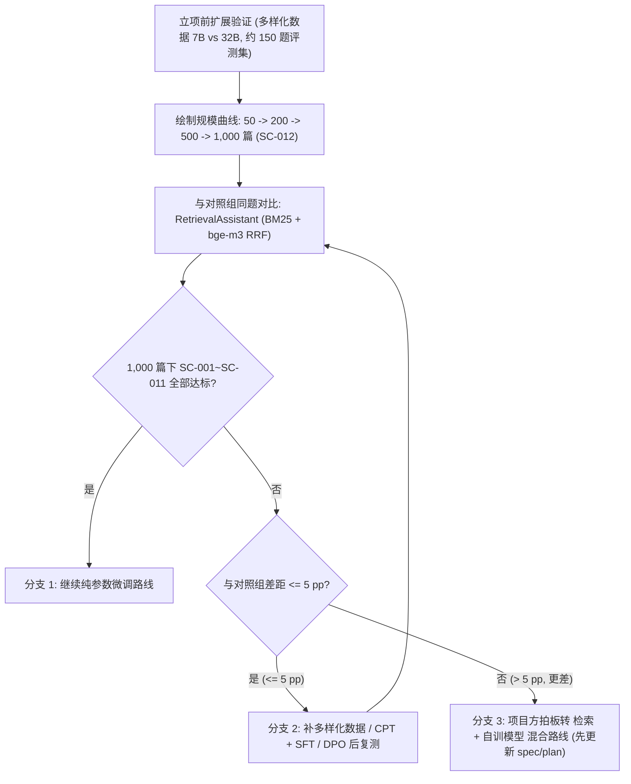

# 第 8 章 复盘与演进：全流程踩坑汇总、POC 边界与正式阶段路线图

本章对应 Phase 7 的 `T074`（总结 Phase 1–7 全流程实践，并按 `specs/001-legal-clause-assistant/tasks.md` 约定集中登记 `T078` 已知缺陷），作为整套学习文档的收官终章。

本章全部结论基于以下冻结基线：
- **冻结 7B 演示模型**：`exp-20261116-resume500`（基座 `mlx-community/Qwen2.5-7B-Instruct-4bit`，Apache 2.0，从 iter-500 续训 8,421 步零 NaN，耗时 `49,593 s`，最终 val loss `0.472`）；
- **活跃知识库**：`kb-20261119-045641`（24 篇法规 / 3,809 条记录 / 67 条已确认关联：`liability_for` 26 + `references` 41）；
- **全量评测与验收基线**：`eval/cases/v1/` 全 7 类 98 题 T064 两次冷启动重复评测（`run-20261123-051432` / `run-20261123-053832` → 本机产物路径 `artifacts/eval/compare-20261123-145054/`，`SC-015 = 0.0 pp` PASS）、`SC-016` PASS、T075 路线 A 结论及 T071 V1–V7 + US4 全 8 场景验收（`462 passed, 6 xfailed`）。

## 本章知识点

| 编号 | 主题 | 核心问题 |
|---|---|---|
| [L8.1](#l81-全流程踩坑总账从环境搭建到演示交付的-6-类高发工程陷阱) | 全流程踩坑总账 | 从环境搭建到演示交付踩过哪些高发坑？提炼出哪 5 条工程铁律？ |
| [L8.2](#l82-poc-说明了什么以及明确没说明什么) | POC 边界实证 | 回扣 [L1.8](./01-big-picture.md#l18-poc-能说明什么不能说明什么)：POC 实打实证明了哪 5 件事，又严禁外推哪 6 件事？ |
| [L8.3](#l83-深度解读校验前引用准确率看清模型真本事与校验层的硬边界) | 深度解读“校验前引用准确率” | 跨 5 组真实 run 横向对比：为什么不能只看校验后，也不能只看校验前？ |
| [L8.4](#l84-poc-已知缺陷与工程限制登记簿含-t078) | 已知缺陷与工程限制登记簿 | `T078` 的精确影响面与修复路径是什么？POC 还有哪 5 项限制？ |
| [L8.5](#l85-正式阶段约-1000-篇文档事项清单与架构决策门禁r12) | 正式阶段路线图（R12） | 迈向 1,000 篇文档：立项前扩展验证、规模曲线、R12 全 15 项与三分支决策关卡怎么走？ |
| [L8.6](#l86-全套学习文档复习路线从第-01-章到第-08-章的核心心法) | 全套学习文档复习路线 | 如果 01–08 每章只记住一句话，核心心法分别是什么？ |
| [L8.7](#l87-可以继续问的问题) | 可以继续问的问题 | 面向正式立项与深度原理的 6 个延展追问 |

---

## [L8.1] 全流程踩坑总账：从环境搭建到演示交付的 6 类高发工程陷阱

下面按项目生命周期汇总本轮 POC 真实踩过的 20 个典型工程陷阱（每条只留“现象 → 根因 → 落地防护”，详细过程请顺着锚点回看对应章节）：

| 阶段分类 | 踩坑现象 | 根因定位 | 修复 / 防护方案 | 详阅 |
|---|---|---|---|---|
| **1. 环境与依赖** | HF 下载极慢且设了镜像仍直连外网 | `hf-xet` 传输层绕过 `HF_ENDPOINT` | 同时设置 `HF_ENDPOINT=https://hf-mirror.com HF_HUB_DISABLE_XET=1` | [L2.11](./02-hardware.md#l211-环境搭建与踩过的坑) |
| **1. 环境与依赖** | 险些误选 `Qwen2.5-3B` 作底座 | 3B 为非商用研究许可，不合规 | 锁死 Apache 2.0 底座（1.5B 流程验证 + 7B 演示） | [L2.11](./02-hardware.md#l211-环境搭建与踩过的坑) |
| **1. 环境与依赖** | 改了 `lora.alpha` 却对训练毫无影响 | `mlx_lm` 不读 `lora.alpha`，只认 `scale` | 配置与清单统一写 `scale`，并在文档中标明与 PEFT 差异 | [L5.2](./05-training.md#l52-超参数逐项解释) |
| **2. 语料与知识库** | 小模型被大部头与非工会文本稀释信号 | 《民法典》2,136 条占全库 1/3，且混入合同范本 | 语料由 28 篇筛选收敛至 24 篇核心法规（3,809 条） | [L3.6](./03-knowledge-base.md#l36-语料准备过程与真实入库数据) |
| **2. 语料与知识库** | 项行误升为独立款号；多款整条引用无法对齐 | 正则未区分项与款；责任条款引用整条多款条文 | 项行并入当前款 + 整条按款展开人审 + 口径 C 兼容回退 | [L3.7](./03-knowledge-base.md#l37-踩过的坑)、[L3.4.1](./03-knowledge-base.md#l341-条与款的定位粒度抽取审阅与校验如何联动) |
| **2. 语料与知识库** | 某地方法规 63/63 条款号整体顺延 `+1` | 括号条旨（如“（鉴定程序）”）被误切为 `p1` | 登记为 `T078` 移出 POC 以稳住 `v1/SC-016` 基线，正式阶段修复 | [L8.4](#l84-poc-已知缺陷与工程限制登记簿含-t078) |
| **2. 语料与知识库** | 测试重导知识库可能劫持活跃线上版本 | `kb.version: null` 会自动加载最新 SQLite | 验证重导一律用 `--artifacts /tmp/...` 隔离，或显式锁定 `kb.version` | [T071 验证记录](../experiments/T071-quickstart-verification.md) |
| **3. 数据合成与建库** | 1.5B 首训 val loss 降了但线上几乎不按格式引用 | 首版 95% 训练样本缺 system prompt，训练/推理分布不一致 | 引入 ≤200 字 `v2-short` 模板实现 100% 覆盖 | [L5.4](./05-training.md#l54-loss-降了--效果好本次就是反例) |
| **3. 数据合成与建库** | `citation_missing` 误杀 8,113 条；行为类仅占 0.5% | 校验未从自然语言反推条款；知识类样本占比过大 | 补反推规则（实丢降至 3,228 条）+ 行为类补量且仅在 train 侧过采样 | [L4.5](./04-training-data.md#l45-质量关卡坏样本不许进训练集)、[L4.7](./04-training-data.md#l47-当前数据集的真实结果) |
| **3. 数据合成与建库** | 续训重切分污染验证集；文章初稿与改稿跨侧泄漏 | 随机重新切分让旧 train 混入新 valid；未按家族分组 | `preserve_split=True` 锁 `valid ∩ ds-8410 train = 0` + Group Split | [L4.5.3](./04-training-data.md#l453-数据集增量更新续训留出集保护与跨请求去重) |
| **3. 数据合成与建库** | 合成文章引用 ID 全对，但案情缺构成要件/责任主体错位 | 自动化校验只查“条款存在”，查不出法律逻辑合理性 | 引入人工逐篇审阅退回机制，沉淀固化文章池 | [L4.5.1](./04-training-data.md#l451-普法文章怎样算一条可训练的样本) |
| **4. 训练与数值稳定** | 4-bit 7B 训练到 iter ~550 突然 NaN 崩盘 | `fp16` 注意力反向溢出（第 27 层 `q_proj` 推高注意力 logit 致 `fp16` 反向溢出 `±65k`） | fp32 注意力 + `mx.where` NaN 守卫 + 日志自动停训三补丁 | [L5.9](./05-training.md#l59-数值精度与注意力分数一次-fp16-溢出事故实录) |
| **4. 训练与数值稳定** | 中断后训练进度归零；长时间命令被 agent shell 杀掉 | `save_every` 缺省等于总步数；后台会话超时回收 | 设 `save_every: 500`，长训改用独立终端 + `caffeinate` | [L5.9](./05-training.md#l59-数值精度与注意力分数一次-fp16-溢出事故实录) |
| **4. 训练与数值稳定** | T075 续训文章后主责条款定位退步且出现正文答反 | 续训发生灾难性遗忘（`17→14/60`、`9→6/60`），`cand-001/032` 答反 | 严守回归门槛拒绝换模，走路线 A 保留 `resume500` | [L5.15](./05-training.md#l515-从已有-adapter-续训怎样看出新数据的作用) |
| **5. 评测与指标误读** | **E002 误把裸基座当自训模型评测，险些误判路线失败** | 客户端传基座全名绕开 `mlx_lm.server` `_adapter_map["default_model"]` | `current.json` 固化 `"default_model"`，评测前必跑 `ab.py` 路由冒烟 | [L5.11](./05-training.md#l511-评测前先确认测的是你的模型e002-实录) |
| **5. 评测与指标误读** | 单指标假象（`SC-006=1.0`、`SC-001=0.9`、聚合持平、25 batch val loss） | 掩盖 `incomplete=25`、零追问、3 升 3 降翻转与空标题循环 | 强制分项拆解、逐题翻转对比、全量 val loss 与人工抽检 | [L6.4](./06-evaluation.md#l64-评测报告怎么读校验前后准确率incomplete-陷阱与人工评审闭环)、[L6.5](./06-evaluation.md#l65-多版本对比与重复评测稳定性fr-035--sc-015为什么同口径和2-个百分点是对比的前提)、[L6.9](./06-evaluation.md#l69-用本项目评测结果分析薄弱类别并反推数据改进方向) |
| **5. 评测与指标误读** | 重复评测受服务端热缓存干扰 | `mlx_lm.server` 维护 `LRUPromptCache` 前缀缓存 | 两轮评测之间各自独立冷启动重启推理服务 | [L6.7](./06-evaluation.md#l67-重复评测确定性边界与ai-初审--人工终判闭环) |
| **6. 服务、编排与演示** | Gradio 6 多线程报 `sqlite3.ProgrammingError` 且加载外链字体 | SQLite 默认 `check_same_thread=True`；默认主题带 Google Fonts | 只读连接 `check_same_thread=False` + 锁 + 禁用遥测与系统字体 | [L7.2](./07-serving-demo.md#l72-本地演示界面的工程边界gradio-6-状态隔离sqlite-跨线程约束与本地隐私护栏) |
| **6. 服务、编排与演示** | 模型超时或异常后会话残留悬挂 `user` 轮污染上下文 | 写入 `user` 轮后未做事务回滚 | `orchestrator.py` 写前打快照，`except Exception` 全链路回滚 | [L7.5](./07-serving-demo.md#l75-对话编排全链路从一条用户消息到可交付回复的-10-步流水线) |
| **6. 服务、编排与演示** | 单机同时跑训练与演示导致卡顿甚至 OOM Kill | 32GB 统一内存叠加 `22.5–28.5+ GB` 且争抢同一内存带宽 | POC 严守“训练前停服务、演示前停训练”，正式阶段物理隔离 | [L7.6](./07-serving-demo.md#l76-为什么训练与演示不能在-m1-pro32gb上同时进行) |

### 跨阶段提炼的 5 条工程铁律

1. **先验路由，再谈效果**：任何评测、演示前先确认命中的是目标 adapter 与目标 KB（`default_model` + `ab.py`），否则所有归因都建立在流沙之上。
2. **训练与推理分布必须字节级对齐**：system prompt、引用格式、上下文结构只要有一处偏差，loss 再低在线上也会失灵。
3. **确定性护栏守底线，概率模型做表达**：条文原文、身份脱敏、篇数上限、零外连白名单必须由可单测的确定性代码锁死，绝不指望提示词“自觉遵守”。
4. **绝不看单一聚合分做决策**：必须同时看分项指标、逐题翻转与代表性原文样本，防范 `incomplete`、零追问、答反与循环退化被平均分掩盖。
5. **换模必须过回归门禁，宁可留旧不带病上线**：T075 证明续训新能力会冲击既有主责定位，没有通过既有基线回归门槛的权重一律不替换。

---

## [L8.2] POC 说明了什么，以及明确没说明什么

在开工之初，我们在 [L1.8](./01-big-picture.md#l18-poc-能说明什么不能说明什么) 写下过一份事前预期边界；现在 POC 全部实测落盘，用真实数据给出正式结案对照。

### 已证实的 5 件事（有实测数据背书）

1. **端到端私有化全链路完全跑通**：24 篇法规 / 3,809 条记录 / 67 条已确认关联 → 8,247 条去重数据集 → 本机 M1 Pro 32GB 4bit QLoRA 12–14 h 完训 → 本地零外连 `tu serve model` + `tu ui`；`quickstart.md` V1–V7 + US4 全 8 个验证场景全部 PASS，自动化测试基线达到 **`462 passed, 6 xfailed`**（详见 [T071 验证记录](../experiments/T071-quickstart-verification.md)）。
2. **纯参数 SFT 确实把私有法律知识训进了模型（`SC-016` 三项全过）**：在 60 题 `clause_id` 评测上，对比同基座裸模型：条级命中 `1/60 → 17/60`（Fisher 精确检验 `p = 4.45e-05`），款/项级精确命中 `0/60 → 9/60 (15.0%)`，基座从未识别出的文件子集 `0/30 → 21/30`（`p = 3.58e-09`）；引用格式学会率 `0/60 → 60/60`，上海地方文件 `0/22 → 14/22`（详见 [POC 训练总结](../experiments/poc-training-summary.md)）。
3. **确定性护栏能守住合规与文面底线**：出处校验层能拦截编造条号（`not_found`）并将已定位引用纠偏至 `97.3%`；身份脱敏达到 `SC-011 = 2/2` 且阻断历史传播；15 篇超限 `91 ms` 毫秒级硬拒；运行时三层零外连防线通过 AST 静态门禁；`kb.version` 支持零改代码热切换知识库。
4. **评测标尺高度稳定可复现（`SC-015` PASS）**：冻结 7B 模型在全 7 类 98 题 `eval/cases/v1` 上完成两次独立冷启动评测（单轮耗时 `21 分 06 秒` / `20 分 56 秒`），98/98 题输出逐字一致，12 项有效指标最大波动 **`0.0 pp`**（远低于 ≤ 2.0 pp 门槛，详见 [T064 重复评测记录](../experiments/T064-eval-repeatability.md)）。
5. **当前真实瓶颈已收敛为“换问法泛化”，而非简单增加训练轮数**：E003 追加 1 epoch 后，训练原题 P2 `28 → 51/100`、P3 `50 → 132/223`（`p < 1e-4`），但独立评测集 v1 几乎不动（条级 `17 → 18/60`，款级仍 `9/60`）——说明模型记住了训练问法，但泛化到陌生问法需要更丰富的**数据多样化**而非盲目多训 epoch。

### 明确没说明（严禁对外夸大或外推）的 6 件事

1. **不可外推至 1,000 篇正式规模**：`SC-012`（1,000 篇规模稳定性）尚未测量；文档增至数十倍后，大量地方条例措辞高度重叠，纯参数化定位难度会非线性上升。
2. **未做“纯微调 vs RAG”同题对照**：POC 未实现 `RetrievalAssistant` 对照组，因此**无法证明纯微调优于或劣于检索增强**。
3. **未做干净的模型规模对照**：1.5B（旧数据集 `ds-kb-20261113-093057-14710`）与 7B（重建数据集 `ds-kb-20261113-093057-8410`）**使用不同数据集，非干净规模对照**（E002 §6.3 已订正）；“14B/32B 更大就更好”在本项目里目前仍是待验证假设。
4. **未证明纯 SFT 已达到正式上线质量目标**：T064 全 98 题实测 `SC-002 = 0.121`、`SC-003 = 0.188`、`SC-004 = 0.150`、`SC-005 = 0.000 (n=2)`、`SC-008` 范围外 `2/4`、`SC-009 = 0/9`——严禁拿精心挑选的演示剧本效果冒充全量召回率。
5. **未验收开放多篇普法文章与主动追问能力**：T075 放弃换模后，冻结演示模型仅支持路线 A（给定案情与核准条款的预审单篇）且简短改稿存在压缩边界（324 字→57 字）；10 道 `intent` 题全轮 `question_count = 0`，主动追问能力尚未学会。
6. **小样本统计功效与法律专家复评尚未补齐**：`refusal`（3 题）、`false_refusal`（2 题）、`exception`（3 题）单题即占 33%–50%，统计波动极大；人工评审也尚未引入外部法律专业人员。

---

## [L8.3] 深度解读“校验前引用准确率”：看清模型真本事与校验层的硬边界

[L6.4](./06-evaluation.md#l64-评测报告怎么读校验前后准确率incomplete-陷阱与人工评审闭环) 与 [L6.8](./06-evaluation.md#l68-全指标计算方法宏微汇总与校验前后深化) 讲清了 `SC-007` 的公式定义；本节把 POC 期间 **5 组真实评测 run** 放在同一张表里横向解构，回答一个对外汇报与正式立项时最关键的问题：**为什么“校验前引用准确率”是拆穿假象的照妖镜，但它本身也有盲区？**

### 5 组真实 run 的 `SC-007` 横向对照（磁盘 `summarize_run` 复算真值）

| Run（实验与模型） | 评测集与规模 | `SC-007` 校验前（全分母） | `SC-007` 校验后（全分母） | 已定位子集（校验前 → 后） | 四态分布（`ok / corr / nf / inc`） | `SC-002` / `SC-003` | 读数揭示的核心真相 |
|---|---|---:|---:|---:|---|---|---|
| `run-20261117-085921`（1.5B，旧数据集） | 旧 KB 60 题 | `0.017` (2/119) | `0.538` (64/119) | `0.030 → 0.970` (66) | `2 / 62 / 2 / 53` | `0.017` / `0.038` | 已定位校验后高达 97%，但校验前仅 1.7%——全靠校验层把 62 处背错原文硬盖过去（注：与 7B **不同数据集，非干净规模对照**） |
| `run-20261117-081504`（7B `resume500`） | 旧 KB 60 题 | `0.567` (34/60) | `0.567` (34/60) | `0.971 → 0.971` (35) | `34 / 0 / 1 / 25` | `0.150` / `0.265` | 只要标出款号就几乎背不错原文（`corr=0`），失分主因是 25 处多款漏写款号（`inc=25`） |
| `run-20261118-020130`（7B `epoch2`） | 旧 KB 60 题 | `0.800` (48/60) | `0.800` (48/60) | `0.980 → 0.980` (49) | `48 / 0 / 1 / 11` | `0.150` / `0.188` | 校验前暴涨 `+23.3 pp`（`inc` 25→11），但 `SC-002` 不动、`SC-003` 反跌 `-7.7 pp`——**证明“校验前高分 ≠ 选条准确”** |
| `run-20261120-183952`（T075 7B 候选） | 新 KB 70 题 | `0.692` (63/91) | `0.780` (71/91) | `0.887 → 1.000` (71) | `63 / 8 / 0 / 20` | `0.096` / `0.120` | 已定位校验后 100%，但 8 道有金标文章题 7 道召回为 0、咨询还出现正文与引文答反 |
| `run-20261123-051432`（T064 冻结 7B） | 新 KB 98 题 | `0.405` (66/163) | `0.669` (109/163) | `0.589 → 0.973` (112) | `66 / 43 / 3 / 51` | `0.121` / `0.188` | `multi_violation` 10 题独占 `38/43 (88.4%)` `corrected`，长文错配条号引发“真条文配错案情” |

### 必须警惕的 3 类典型误读陷阱

1. **陷阱 A：把校验后 97% 当成“模型记住了”**——看 1.5B（`run-20261117-085921`），已定位校验后高达 `0.970`，但校验前只有 `0.030`（全分母 `0.017`）；一旦把校验层拿掉，模型几乎逐条背错。
2. **陷阱 B：把 `corrected` 暴增当成“校验层立大功”**——看 T064（`run-20261123-051432`），`multi_violation` 10 题独占 `38/43 (88.4%)` 的 `corrected`。校验层只能按模型给的条号替换成“真的法条原文”，却**救不了“张冠李戴”**（如 `mv-001/008` 把毫不相干的条号配进案情，越替换越显得一本正经地胡说八道）。
3. **陷阱 C：把校验前高分当成“回答正确”**——看 `epoch2`（`run-20261118-020130`），校验前冲到 `0.800`（`+23.3 pp`），但 `SC-002` 纹丝不动、`SC-003` 反跌 `-7.7 pp`；又如 T064 中 `false_refusal` 2 题引文 `ok=2/2`（校验前 100%）却因错引邻近条号导致 `Recall=0.000 / Precision=0.000`，以及 T075 的 `cand-001` / `cand-032` 引文 `ok=1/1` 但正文答成与紧随引文直接相反的结论。**校验前只衡量“引出的条号与背出的原文是否一致”，不衡量“是不是该引这条”或“正文分析对不对”**。

### 对外汇报与立项决策的“四联看板”读法

以后看任何一次评测，绝不单报 `SC-007`，必须四项并列：
1. **校验前 `ok/all` + `inc` 占比**：衡量模型自身记忆与规范标注能力；
2. **校验后 `(ok+corr)/all` + `corr` 预警**：衡量交付文面底线，同时 `corr` 骤增即亮红灯排查张冠李戴；
3. **`SC-002`（召回）与 `SC-003`（精确）**：衡量模型到底有没有**选对条款**；
4. **正文与引文语义一致性人审**：防止“引文全对、正文答反”的隐蔽事故漏网。

---

## [L8.4] POC 已知缺陷与工程限制登记簿（含 T078）

### 1. 重点档案：`T078`（《上海市工伤保险实施办法》括号条旨误切款号）

- **编号与状态**：`T078`（`[Post-POC / 正式阶段]`，2026-11-19 经用户确认移出 POC，详见 `specs/001-legal-clause-assistant/tasks.md`）。
- **根因与影响范围**：`src/tu_assistant/kb/parse.py` 将《上海市工伤保险实施办法》（`doc_id: 9fc301cd90566af9`）每条首行的括号条旨（如第 27 条“（鉴定程序）”及第 43 条括号条旨）误切为 `paragraph_no=1`，导致该文件 **63/63 条**款号整体顺延 `+1`（例如第 43 条真实第 1 款引导款顺延为 `p2`、其第 2 项落为 `p2:i2`）。经核查，全库 24 篇法规中仅此 1 篇受影响（本机诊断报告路径：`artifacts/logs/t019/p1_heading_diagnosis.md`）。
- **受影响清单**：
  - `eval/cases/v1/reviewed.jsonl`：精确受影响 **5 题**——`cand-007`、`cand-036`、`cand-039`（`SC-016` 稳定命中基线之一）、`cand-048`、`cand-054`；
  - `eval/cases/v1/articles.jsonl`：**0 题**；
  - 活跃 KB 67 条已确认条款关联：**0 条**（T019 第二批行 18–25 共 8 条关联候选已整组 `reject` 暂搁）。
- **POC 处置**：保持历史 KB、旧数据集与 `v1/SC-016` 基线零改动；已在 T057 数据集 `manifest.json`（`known_issues`）、[演示场景脚本](../demo-scenarios.md)（全剧本 0 处引用该文件款号）与本章完成集中登记。
- **正式阶段修复路径**：修 `kb/parse.py` 剥离首行纯括号条旨入条款元数据 → 该文件款号回退 `-1` 且项号重挂真实第 1 款 → 生成新 KB 版本 → 同步修订受影响 5 题 `gold.clauses` 并升级评测集基线（如 `v2`）→ 重抽并人工确认该文件条款关联（补回 T019 行 18–25）。

### 2. 其余 5 项 POC 已知限制汇总

| 编号 | 限制项 | 现状与边界说明 | 详阅 |
|---|---|---|---|
| **K-1** | 冻结模型 US2 路线 A 与简短改稿边界 | 演示模型保留 `resume500`，US2 限于给定案情与核准条款的预审单篇；V6 Step 4 第 2 轮简短改稿存在内容压缩边界（324 字→57 字） | [T075 实验记录](../experiments/T075-article-training.md)、[T071 验证记录](../experiments/T071-quickstart-verification.md) |
| **K-2** | 新 KB 责任关联覆盖不均（T057 登记） | 《劳动法》与《劳动合同法》在新 KB 仅含 `references` 缺 `liability_for`，导致 POC 文章池未覆盖这两部高频法；26 对已确认 `liability_for` 无额外未引用出边 | [T057 执行单](../handoffs/T057-article-dataset-handoff.md) |
| **K-3** | 评测度量 4 处边界与 `SC-008` 6 条 `xfail` | `SC-003` 对 6 道空 `gold` 题计 `0.0`；多轮指标仅评末轮；`SC-004` 未自动判主体名；`detect_refusal` 存在 6 条 `xfail(strict=True)` 已知语义边界 | [L6.2](./06-evaluation.md#l62-怎样读-sc-008-的拒答初筛结果)、[L6.8](./06-evaluation.md#l68-全指标计算方法宏微汇总与校验前后深化) |
| **K-4** | 身份脱敏字面规则覆盖边界 | 仅覆盖常见单姓人名 + 五类单位字面全称，不覆盖复姓、简称、内部部门名、证件号或谐音变体 | [L6.3](./06-evaluation.md#l63-文章脱敏接线后怎样读-sc-011-与真实生成差异) |
| **K-5** | 语料元数据启发式推断与自动切库运维约束 | 24 篇均缺显式版本标签；`kb.version: null` 自动切库在本地测试重导时须 `--artifacts /tmp/...` 隔离或显式锁定版本号 | [L3.3.1](./03-knowledge-base.md#l331-知识库更新版本差异比对与校验生效-vs-参数重训的边界)、[L3.6](./03-knowledge-base.md#l36-语料准备过程与真实入库数据) |

---

## [L8.5] 正式阶段（约 1,000 篇文档）事项清单与架构决策门禁（R12）

POC 已经把 24 篇法规的私有化链路、护栏与标尺全部打通；迈向约 **1,000 篇文档** 的正式阶段，绝不是“直接买台大显卡把现成脚本再跑一遍”，而是要严格遵循 `specs/001-legal-clause-assistant/research.md` R12 的实证决策路径。

### 1. 立项前必做：小规模扩展验证

在采购长期算力或全面铺开 1,000 篇数据前，先在租用 GPU 上完成一次低成本验证：
- 用**多样化训练数据**分别训练 **7B 与 32B** 两个规模，在扩充至约 **150 题**的人工评测集上做同数据对照，拆开测量“数据多样化”与“模型规模”各自带来的增益；
- 本项目的投入优先级排序已收敛为：**`数据多样化 > 模型规模 > 训练配置`**。公开研究（Ovadia 等 2023、Allen-Zhu & Li *Physics of Language Models* Part 3、Gekhman 等 2024）均指向类似规律（*注：公开研究的任务与语料场景不完全相同，此处仅印证方向，不能直接推算本项目的指标数字*）。

### 2. 1,000 篇规模曲线与三分支架构决策关卡

正式阶段必须按 **`50 → 200 → 500 → 1,000 篇`** 绘制规模曲线（`SC-012` / `FR-036`），并与同一基座未微调的检索对照组（`RetrievalAssistant`：`BM25 + bge-m3` 向量检索按条款召回 + `RRF` 融合）同题对比，再按 **5 个百分点（`5 pp`）** 门槛拍板：

### 3. R12 正式阶段全量 15 项演进清单

| # | 事项 | POC 现状 | 正式阶段目标（`research.md` R12） |
|---|---|---|---|
| 1 | **规模验证** | 24 篇法规（3,809 条） | 在 50 / 200 / 500 / 1,000 篇下测规模曲线（`SC-012` / `FR-036`） |
| 2 | **对照组** | 未实现 `RetrievalAssistant` | 实现 `BM25 + bge-m3` 向量按条款召回 + `RRF` 融合 + 未微调同一基座 |
| 3 | **决策关卡** | 仅验证 `SC-016` 有效性 | 1,000 篇全达标→继续微调；与对照差 `≤ 5 pp`→补数据/方案再测；差 `> 5 pp`→项目方拍板转混合路线 |
| 4 | **训练方案** | 单阶段 QLoRA SFT | CPT（原文 + 改写 ×~10 + 条款关系 + 通用语料）+ SFT + 按需 DPO + 系统性数据多样化 |
| 5 | **基座** | `Qwen2.5-7B-Instruct-4bit` | 评估 `Qwen3.5-9B` 等新模型，并用同批数据做 7B / 14B / 32B 干净对照 |
| 6 | **立项前扩展验证** | 尚未执行 | 租 GPU 用多样化数据对比 7B vs 32B，在约 150 题人工评测集拆测数据与规模增益 |
| 7 | **knowledge 全量重训（E003 B2）** | 5 个 gold 条款零曝光留待后续 | 补齐 5 个零曝光 gold 样本并全量重训，验证零曝光补齐收益 |
| 8 | **训练硬件** | 本机 M1 Pro 32GB（4bit QLoRA） | RTX 5090（bf16 LoRA）；必要时按需租用云 GPU 做全参微调 |
| 9 | **推理服务** | 本机 `mlx_lm.server`（与训练互斥） | 独立推理节点部署 `vLLM`，与训练节点物理隔离 |
| 10 | **评测集** | 98 题人工/半自动评测 | 扩至 `≥ 200 题`，引入用户模拟器、评判模型与法律专业人员复评 |
| 11 | **数据合成** | 外部 API 离线合成 | 5090 本地 27–35B 开源模型主力合成 + 关键节点外部 API 复核 |
| 12 | **条款关联** | 规则抽取 + 人工确认（67 条） | 规则 + 人工 + 大模型辅助分类协同提效 |
| 13 | **知识库更新** | 整批重导生成新 SQLite | 演进为增量更新，并优先落地 `T078` 解析修复与基线升级 |
| 14 | **评审意见** | CSV 表格（`eval/review-template.csv`） | 系统内直接录入与追踪评审意见（`FR-037`） |
| 15 | **存储** | 单文件只读 SQLite | 按多人并发与权限需求评估迁移至 `PostgreSQL` |

---

## [L8.6] 全套学习文档复习路线：从第 01 章到第 08 章的核心心法

| 章节 | 核心命题 | 如果只记住一句话 | 本项目代表性真实锚点 |
|---|---|---|---|
| [01 全局视角](./01-big-picture.md) | 路线选择与架构边界 | 微调教“内化知识与行为”，出处校验层给概率模型兜住法条原文底线 | [L1.6](./01-big-picture.md#l16-出处校验层给模型的记忆兜底)、[L1.8](./01-big-picture.md#l18-poc-能说明什么不能说明什么) |
| [02 硬件与环境](./02-hardware.md) | 内存账本与算力现实 | 4bit QLoRA + `--grad-checkpoint` 让 32GB Mac 也能训 7B，但吞吐与内存决定了 POC 边界 | 峰值 `23 GB → 11.5 GB`（[L2.8](./02-hardware.md#l28-梯度检查点用时间换内存)） |
| [03 知识库](./03-knowledge-base.md) | 法规结构化与出处校验 | 条款切分决定一切上限，出处校验只能改原文、救不了选错条号 | 24 篇 / 3,809 条 / 67 条关联（[L3.4.1](./03-knowledge-base.md#l341-条与款的定位粒度抽取审阅与校验如何联动)） |
| [04 训练数据](./04-training-data.md) | 数据合成与防泄漏 | 数据质量与分布决定模型上限，续训必须守住验证集不污染与家族不跨侧 | `valid ∩ ds-8410 train = 0`（[L4.5.3](./04-training-data.md#l453-数据集增量更新续训留出集保护与跨请求去重)） |
| [05 训练](./05-training.md) | 数值稳定与真实归因 | loss 降不代表效果好，评测前先确认命中的是你的 adapter 而非裸底座 | E002 误测基座与 E003 泛化瓶颈（[L5.11](./05-training.md#l511-评测前先确认测的是你的模型e002-实录)、[L5.15](./05-training.md#l515-从已有-adapter-续训怎样看出新数据的作用)） |
| [06 评测](./06-evaluation.md) | 标尺设计与错误归因 | 先有稳定可复现的标尺，再把低分拆成“数据 / 能力 / 测量”三类反推改进 | T064 98 题 `SC-015 = 0.0 pp`（[L6.7](./06-evaluation.md#l67-重复评测确定性边界与ai-初审--人工终判闭环)、[L6.9](./06-evaluation.md#l69-用本项目评测结果分析薄弱类别并反推数据改进方向)） |
| [07 推理与演示](./07-serving-demo.md) | 服务隔离与工程交付 | 用 OpenAI 兼容接口解耦引擎，用确定性编排流水线把模型关进安全笼子 | 10 步流水线与 M1 Pro 互斥（[L7.4](./07-serving-demo.md#l74-模型服务与运行时隔离openai-兼容接口currentjson-路由与零外连防线)、[L7.6](./07-serving-demo.md#l76-为什么训练与演示不能在-m1-pro32gb上同时进行)） |
| **08 复盘（本章）** | 诚实边界与演进决策 | 诚实区分“已证实”与“未证明”，用规模曲线与 `5 pp` 关卡驱动正式阶段决策 | 5-run `SC-007` 对照、`T078` 建档与 R12 15 项（[L8.3](#l83-深度解读校验前引用准确率看清模型真本事与校验层的硬边界)、[L8.5](#l85-正式阶段约-1000-篇文档事项清单与架构决策门禁r12)） |

---

## [L8.7] 可以继续问的问题

- 当语料从 24 篇扩大到 1,000 篇时，大量地方条例措辞高度相似会怎样冲击纯参数化模型的条款定位？为什么说 `50 → 200 → 500 → 1,000` 规模曲线必须尽早画出来？
- 正式阶段引入 `CPT + SFT` 两阶段训练，为什么比单阶段 SFT 更适合往模型里灌大规模私有法律知识？CPT 阶段为什么要混入一定比例的通用语料？
- 面对“条号真实存在但与案情不匹配（张冠李戴）”的错误，DPO（偏好优化）具体能缓解到什么程度，又有哪些场景必须靠检索或规则兜底？
- 如果规模曲线最终触发“检索 + 自训模型”混合路线，它和“检索 + 通用大模型（纯 RAG）”在业务分工与成本结构上有什么本质区别？
- 评测集扩充到 `≥ 200 题` 并引入用户模拟器与评判模型（LLM-as-a-Judge）后，怎样设计抽检机制来防止裁判模型的系统性偏置？
- 正式阶段修复 `T078` 后，受影响的 5 道评测题金标会变化，怎样在升级到 `eval/cases/v2` 的同时保留与 POC `v1` 基线的历史可比性？
